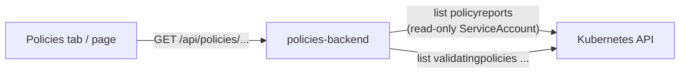

# How it works

Kyverno writes one `PolicyReport` per object, named by the object's UID, with a `scope` that names the object and a `results` list.
The backend lists the reports of the namespace and keeps those whose `scope.name` is the workload's name or starts with `<name>-`.

!!! note "A naming convention, not magic"
    Our charts name everything of a workload after it (Deployment `frontend`, ReplicaSet and Pod `frontend-<hash>`, Service
    `frontend`), so the prefix rule finds exactly the workload's objects. A workload whose objects are named differently will not be
    matched; give it a naming that follows the charts, or extend the matching.

| Endpoint | Returns |
|---|---|
| `GET /api/policies/workload?namespace=&name=` | Summary counters, the number of objects, and the findings |
| `GET /api/policies/policies` | The installed policies (kind, name, action, ready) |

Both require a signed-in user. Names are validated as Kubernetes names.
